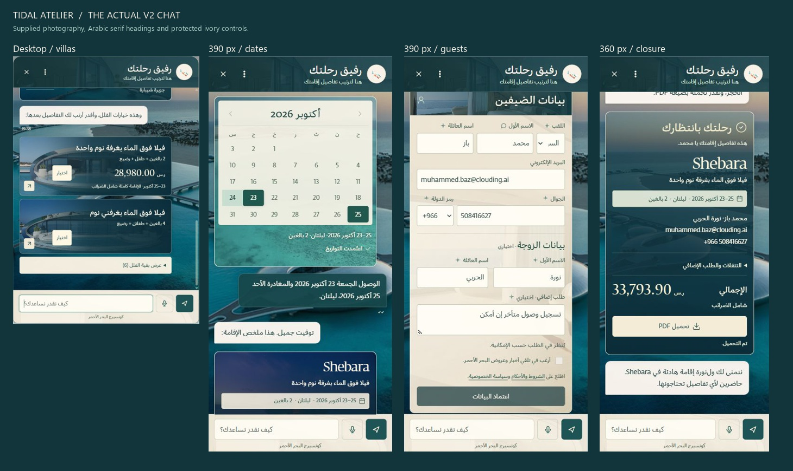
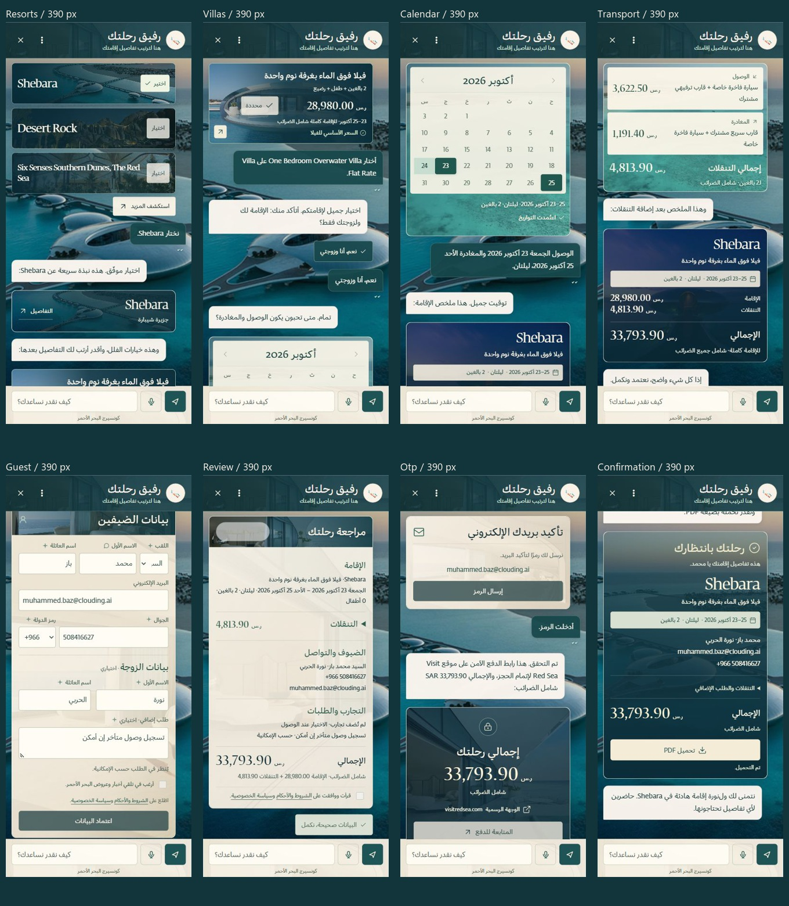

# Tidal Atelier — contextual V2 acceptance review

20 October 2026. Implemented in `visitredsea-chat-mockup-v2`; V1 and the earlier proposal remain separate.

## Preview and evidence

- Working application: http://127.0.0.1:8090/?open=1
- Actual application with responsive wrapper: http://127.0.0.1:8090/tools/responsive-preview.html
- Recorded visual review: http://127.0.0.1:8090/tools/responsive-preview.html?recorded=1&height=844&width=390

The recorded review is the existing scripted journey inside the actual chat shell. It is explicitly labeled outside the customer interface. Its final verification/payment/confirmation states demonstrate appearance, not a live provider result. Normal application sessions use the original booking engine and services. The wrapper resizes the same iframe without restarting its conversation.

## Visual checks

All 15 groups were inspected inside the V2 message column at a 472 px desktop panel, 390 px mobile, and 360 px mobile. `visual-checks.json` records root width, panel geometry, image loading and overflow checks. There were no broken visible images or horizontal overflows. The 390 px panel's fractional 390.4 px browser rounding does not create document scrolling. Both normal short viewport and 844 px phone-height contexts were inspected.

`review-{desktop|390|360}-*.png` contains 45 component-context captures, with corresponding `*-chat.png` crops. `tall-*.png` adds full-height captures. The crops retain the real chat header, background and composer; they are not standalone component mockups. `capture-metadata.json` and `tall-capture-metadata.json` record their source geometry. `desktop-villas.png`, `desktop-calendar.png` and `normal-calendar-invalid.png` come from a manually exercised normal booking session. Other component evidence uses the recorded journey.

Selected original screenshots, including their surrounding application/review context:

| Component | Desktop | Mobile |
|---|---|---|
| Resorts / villas | [Active villas](desktop-villas.png) | [390 resorts](tall-390-resorts.png), [360 villa](tall-360-villas.png) |
| Calendar | [Desktop](tall-desktop-calendar.png), [invalid state](normal-calendar-invalid.png) | [390](tall-390-calendar.png), [360](tall-360-calendar.png) |
| Transport | [Desktop](tall-desktop-transport.png) | [390](tall-390-transport.png) |
| Experiences | [Desktop](review-desktop-experiences.png) | [390](tall-390-experiences.png) |
| Guest form | [Desktop](tall-desktop-guest.png) | [390](tall-390-guest.png), [360](tall-360-guest.png) |
| Review | [Desktop](tall-desktop-review.png) | [390](tall-390-review.png), [360](tall-360-review.png) |
| Verification | [Real code entry](normal-desktop-otp-code.png), [invalid](normal-otp-invalid.png), [verified](normal-otp-verified.png) | [390 initial](tall-390-otp.png), [360 initial](tall-360-otp.png) |
| Payment | [Normal server-verified path](normal-payment.png) | [390 recorded](tall-390-payment.png) |
| Confirmation | [Desktop recorded](tall-desktop-confirmation.png) | [390 recorded](tall-390-confirmation.png), [360 recorded](tall-360-confirmation.png) |

The supplied Arabic serif Book/Demi files were inspected for actual Arabic glyph coverage. Arabic joining, long villa labels, Six Senses' full official name, English brand names, contact details and Western prices were inspected in the rendered application. Inputs retain the supplied Fedra Sans AL. Backgrounds use independent image and contrast layers; no parent component opacity fades essential content. Each villa/resort/experience retains its genuine mapped photo.

## Focused functional regression

The normal journey was manually exercised through these actions:

- Remembered first name; exactly three resort suggestions; Shebara selection.
- All eight villa photographs through progressive disclosure; independent information links; the selected villa and sole quoted rate.
- Party Quick Reply emits one customer message. Calendar empty/first/invalid/complete/confirmed states; 23–25 October remains two nights.
- Free-text refusal `غير موافق` at accommodation approval stays at that gate and creates no arrival modes. The contextual affirmative Quick Reply continues correctly.
- One airport form; blank validation; Yanbu arrival / RSIA departure; optional flight details remain empty.
- Arrival 3,622.50; departure 1,191.40; transfer subtotal 4,813.90; full-stay accommodation 28,980.00; grand total 33,793.90; taxes included.
- Transfer approval; double-clicked experience deferral emits exactly one customer message and adds no paid activity.
- Guest required-field validation; first name remembered; email starts empty and is typed manually; wife/request fields; marketing remains unchecked.
- Edit prefill; cancelling a changed request retains saved data; saving a changed email propagates to the new review. Source preserves verification invalidation when email changes.
- Review Quick Reply without terms does not create verification. It shows the Arabic terms error and contextual fallback Quick Reply. Explicit checkbox acknowledgement reaches the real verification card and its status check; no real mail was sent.
- A second server on port 8091 used the existing localhost SMTP sink on port 2526, with process-only configuration. It sent no message to an external provider. The actual client requested a challenge, displayed six code cells and the resend cooldown, received a wrong-code response, then verified the locally received code through the original server API. `normal-desktop-otp-code.png`, `normal-otp-invalid.png`, `normal-otp-verified.png` and `normal-payment.png` capture this normal service path. No payment link was clicked. The isolated server/sink were stopped afterwards; the 8090 preview configuration was unchanged.
- Reading position stayed at scrollTop 2426.4 while later summary/approval replies increased the document height from 3964 to 4478. Header typing remained active for the queue, and the new-messages control appeared. The first reply retains its original one-time positioning behavior.
- Confirmation PDF action exports a valid one-page A4 PDF; the exported page was rasterized with Poppler and visually inspected for Arabic shaping, guest details, exact dates and totals. `js/pdf.js` is unchanged. The exported file is regression evidence rather than a verified booking receipt.

`node --check js/chat.js` passes. Browser application error logs were empty in the reviewed normal and recorded sessions. `preserved-modules.json` records unchanged server, PDF and factual data modules. The existing checkout URL and its parameters remain intact.

## Scope and live-service limits

No real verification email, microphone permission request, external checkout navigation or purchase was triggered. Real microphone recording/playback and prepared voice extraction were preserved by inspection; live microphone hardware was not tested. Prepared extraction remains a documented mapping and leaves email empty. SMTP and PDF server/data modules were not rewritten. The local SMTP regression tested code-entry, cooldown, wrong-code and verified states; provider-specific failures/expiry and live delivery were not exercised. The five-second payment continuation remains scripted presentation behavior and does not verify payment. No booking reference or payment receipt was added. Missing prices and dedicated links for the other villas remain missing; they require a fresh quote.

The PDF keeps its original supplied RSG logo and corporate identity, including the documented font fallback. Full implementation notes and image-family mapping are in `../../docs/PHOTOGRAPHIC_ATELIER.md`.
