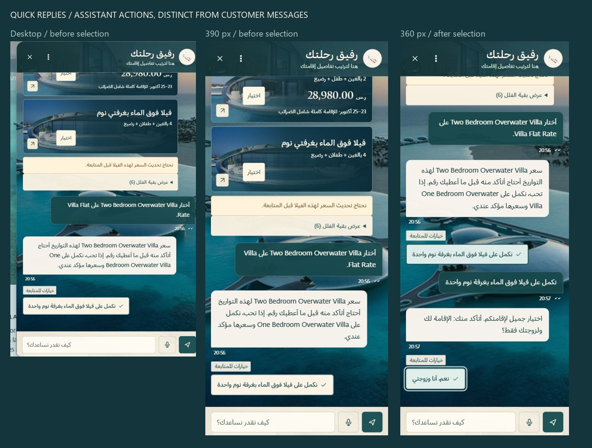

# Quick Reply separation and composer caption removal

20 October 2026. Two targeted V2 changes; the photographic components remain approved and unchanged.

Working preview: http://127.0.0.1:8090/?open=1

## Changed source files

- `css/atelier.css`: explicitly left-aligned Quick Reply group and label; ivory active buttons, aqua hover/focus and consumed states, deep teal text, stronger primary border. Removed the unused caption rule. Existing component, message, header, composer-control and background rules are unchanged.
- `js/chat.js`: a visible, compact `خيارات للمتابعة` label inside the existing `C.quick` group and its matching accessible group label. Dispatch, stage guards and all other rendering/engine code are unchanged.
- `index.html`: removed the caption paragraph. All remaining markup, including the input, microphone, recorder, errors and Send controls, is unchanged. Its flex layout no longer reserves the caption's row or gap.

`baseline/` contains the three pre-change files. `source-scope.json` records exact source comparisons proving that changes outside the requested scope were not introduced. `node --check js/chat.js` passes.

## Actual chat verification

- Desktop chat panel: 472 px. Mobile iframe widths: 390 and 360 px.
- No horizontal overflow. Labels and buttons start at the assistant column's physical left edge while Arabic text stays RTL.
- All measured Quick Reply buttons are at least 44 px high. A longer contextual villa label fits at both phone widths.
- Active surface is RGB 251/243/230; consumed surface RGB 221/236/232; text RGB 32/79/80. No Quick Reply state uses the customer bubble's dark teal fill.
- Keyboard focus was exercised on the next active suggestion at 360 px: pale aqua RGB 225/239/235 and a visible outline.
- Caption element count is zero at every size. Input and microphone/Send sizing and styling are preserved.
- A normal booking conversation was exercised: typed name/intent, selected Shebara, selected the unquoted second villa, then used its contextual `villa_supported` suggestion. Double-clicking increased customer messages from 4 to 5, consumed that group, and reached the correct `party` stage with one `party_yes` suggestion. The actual customer reply retains its original dark teal bubble on the right.
- All booking, form, consent, OTP, payment, recording, PDF and navigation code is identical outside the Quick Reply label. No live email, microphone permission or checkout was triggered by this UI check.

`layout-checks.json` stores dimensions, colors and dispatch counts. `capture-metadata.json` stores the source geometry for the screenshots and their chat-only crops.

## Screenshots from the actual chat

The before/after images are from the normal, interactive booking engine. “Before” means before clicking the newly styled suggestion, not the old design.

| Width | Before selection | After selection |
|---|---|---|
| Desktop | [Original screenshot](before-desktop.png) | [Original screenshot](after-desktop.png) |
| 390 px | [Original screenshot](before-390.png) | [Original screenshot](after-390.png) |
| 360 px | [Original screenshot](before-360.png) | [Original screenshot](after-360.png) |

Additional `recorded-*.png` images verify selected/consumed multi-choice groups in the existing labeled recorded journey. They are visual-state evidence, not live service results.

